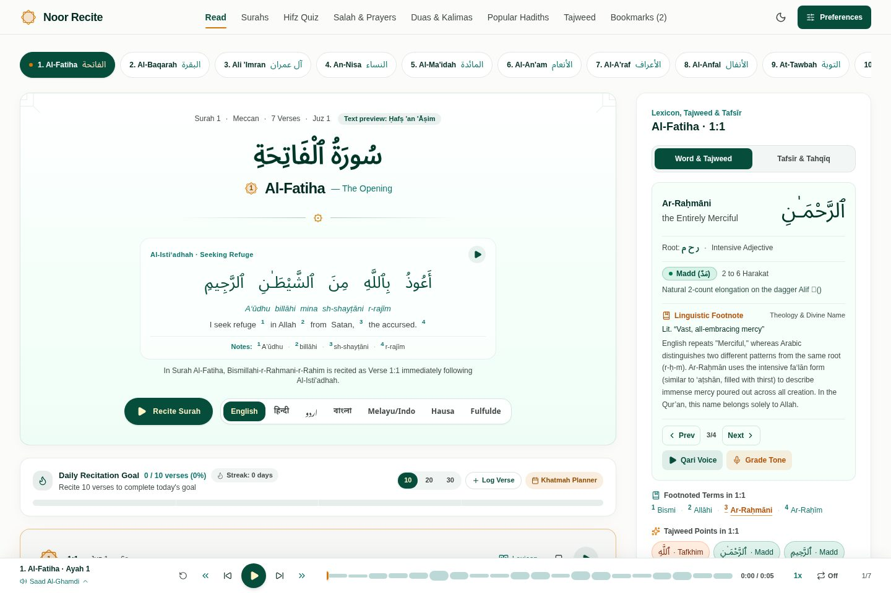
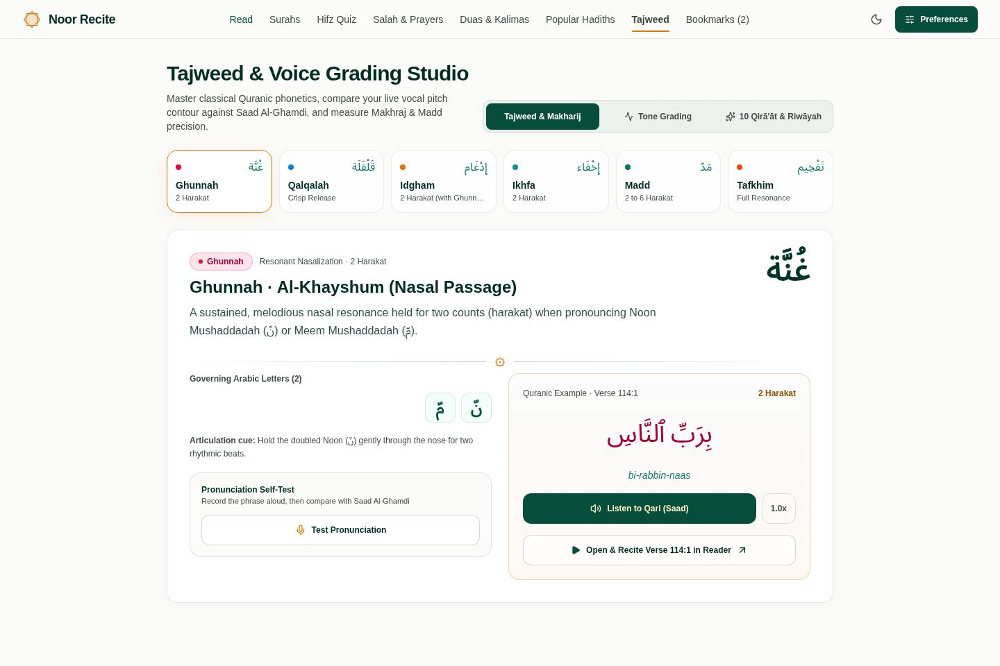
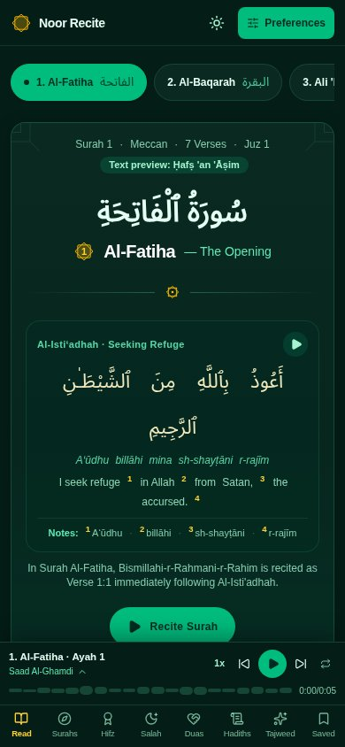

<div align="center">

# Noor Recite

**Quran reading, recitation practice, and everyday study.**

A responsive reading space with recorded recitations, word-level study, memorization drills, and a dedicated Tajweed studio.

[](https://github.com/khalilm3264/Noor-Recite/actions/workflows/checks.yml)


[Quick start](#quick-start) · [User guide](https://github.com/khalilm3264/Noor-Recite/wiki/User-Guide) · [Wiki](https://github.com/khalilm3264/Noor-Recite/wiki) · [Report an issue](https://github.com/khalilm3264/Noor-Recite/issues)

</div>



## Explore the app

| Area | What you can do |
| --- | --- |
| **Reader** | Read Arabic alongside translations and transliteration, select words for study, choose a recorded reciter, and adjust reading preferences. |
| **Surahs** | Browse the chapter directory and open a surah in the reader. Additional chapters depend on external Quran data services. |
| **Hifz Quiz** | Practice word completion, blind recall, next-ayah recall, and voice drills; revisit weak words through spaced review. |
| **Tajweed studio** | Study rule examples, compare recordings, and practice with microphone-based feedback. |
| **Prayer and study** | Browse Salah material, duas, kalimas, and selected hadiths. |
| **Personal reading** | Save bookmarks and collections, set daily goals, and track reading progress in this browser. |
| **Appearance** | Switch between light parchment and night cypress themes, with layouts for phones and desktops. |

### A closer look

<table>
<tr>
<td width="72%" valign="top">

<p><strong>Tajweed studio</strong><br>Rule explanations, example audio, and guided practice.</p>
</td>
<td width="28%" valign="top">

<p><strong>Phone reader</strong><br>Night mode and bottom navigation.</p>
</td>
</tr>
</table>

These are actual app screenshots from the reliability-update build, captured at desktop and phone widths. See [image notes](docs/images/README.md).

## Quick start

**Requirements:** Node.js 24+ and npm. A Gemini API key is optional for the basic reader and required for AI features.

```sh
git clone https://github.com/khalilm3264/Noor-Recite.git
cd Noor-Recite
npm ci
cp .env.example .env
npm run dev
```

Open **http://localhost:3000**. On Windows PowerShell, use `Copy-Item .env.example .env` instead of `cp` if needed.

To enable AI features, edit `.env` and set `GEMINI_API_KEY` to your own server-side key. Keep `.env` private. Never put the key in a `VITE_` variable or browser code.

| Command | Purpose |
| --- | --- |
| `npm run dev` | Start Express with Vite development support. |
| `npm test` | Run verification and AI-protection regression tests. |
| `npm run lint` | Run the TypeScript checker; this is not an ESLint command. |
| `npm run build` | Build the frontend into `dist/`. |
| `npm start` | Start the server; set `NODE_ENV=production` to serve the built frontend. |

Bun is also supported through `bun install --frozen-lockfile`. Both npm and Bun lockfiles are tracked.

## What needs a connection?

The basic reader starts without Gemini. Loading additional chapters, translations, recorded audio, and web fonts uses external services. Some resources may be cached after use; the app does **not** promise complete offline availability.

AI-generated speech, some translation requests, and voice verification go through the Express server to Gemini. Recitation audio submitted for verification leaves the browser. Preferences and reading-progress records are stored locally in browser storage and do not provide account synchronization. See [AI and privacy](https://github.com/khalilm3264/Noor-Recite/wiki/AI-and-Privacy).

## Practice and text-preview limits

- **Tajweed feedback is a practice aid.** Speech matching, voice duration, and volume do not establish correct pronunciation or replace a qualified teacher. Unavailable or malformed speech verification cannot produce a self-test pass.
- **Warsh is a limited text preview.** Only verses **1:4 and 2:9** are adjusted. Other verses retain the base Ḥafṣ text. Reader audio follows the separately selected reciter. This is not a complete Warsh Muṣḥaf.
- **Generated content needs review.** AI speech and translations can make mistakes. Recorded reciter audio and AI-generated speech are separate features.

## Deployment

Build before running the production server:

```sh
npm ci
npm run build
NODE_ENV=production npm start
```

In PowerShell, set `$env:NODE_ENV='production'` before `npm start`. Set `APP_URL` to the exact public origin and provide `GEMINI_API_KEY` as a server-side secret. For Google Drive sign-in, set the `VITE_FIREBASE_*` variables listed in `.env.example` in the build environment (they are baked into the bundle, so sign-in also works on a static host); the Express server additionally serves them from `/api/firebase-config`. The AI features need the Express server; a static-only host does not provide the `/api/*` routes. Microphone recording requires HTTPS or localhost.

AI endpoints have per-client request limits, cross-site browser checks, and a shared provider-call budget. Defaults are **30 requests/minute**, **200 requests/day per client**, **300 provider attempts per 24 hours**, and **3 simultaneous provider calls**. Retries and fallbacks consume the budget. These counters are **per process**, reset on restart, and are not authentication or a provider billing limit. Configure provider-side quotas too; multiple replicas require shared enforcement.

See [setup and deployment](https://github.com/khalilm3264/Noor-Recite/wiki/Getting-Started) for proxy settings, environment variables, and troubleshooting.

## Project map

```text
src/components/       Reader, study screens, and preferences
src/data/             Quran data adapters and curated study material
src/utils/            Audio, practice feedback, localization, and local progress
server.ts             Express routes and Gemini integration
server/               Request protection and provider-call budget
tests/                Regression tests
wiki/                 Version-controlled copies of wiki pages
docs/images/          App screenshots used in this README
```

Built with **React 19**, **TypeScript**, **Vite**, **Tailwind CSS**, **Express**, and the **Google GenAI SDK**. Data/audio adapters reference Quran.com, AlQuran Cloud, and EveryAyah; fonts are requested from Google Fonts. This listing does not imply endorsement or ownership of their content. See [architecture and sources](https://github.com/khalilm3264/Noor-Recite/wiki/Architecture-and-Sources).

## Contributing

Please read [CONTRIBUTING.md](CONTRIBUTING.md). For text, translation, or recitation corrections, include the surah/ayah, the exact issue, and a reliable source. For bugs, include the browser, device, and reproduction steps without API keys or private recordings.
